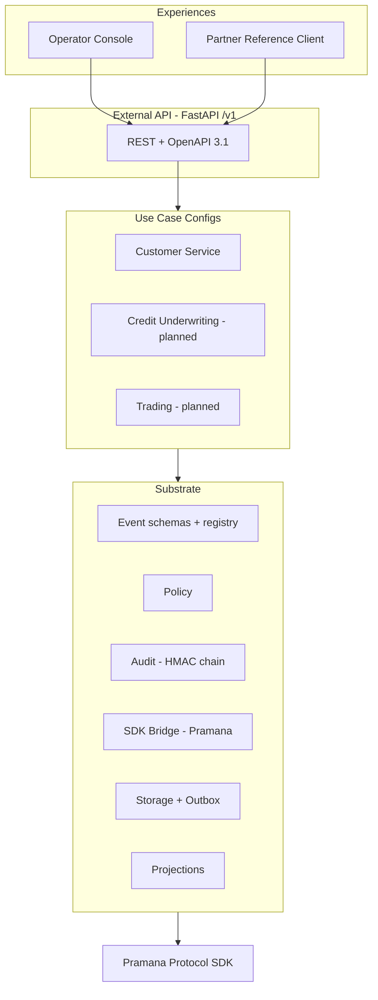
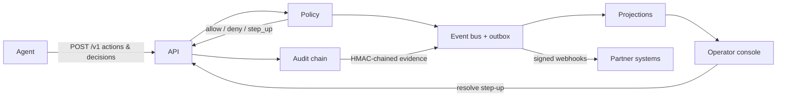

<div align="center">

# Kavach Platform

**Agent Accountability for Indian BFSI**

_The trust substrate for AI agents deployed in banking, financial services, and insurance._


</div>

---

## What is Kavach?

Kavach is the commercial layer [Aurvia Global](mailto:vinay@aurviaglobal.com)
offers to BFSI enterprises: the operational accountability layer for
autonomous AI agents in regulated workflows. It answers, in real time and
post-hoc, with cryptographic evidence:

- **What** did the agent do?
- **On whose authority?** (credential + delegation chain)
- **Was it in scope?** (policy decision)
- **What drove the decision?** (evidence, reasoning, confidence)
- **Did a human need to approve it?** (graduated step-up)

It is built on the [Pramana Protocol](https://github.com/vinaysflow/pramana-protocol)
(AGPL-3.0 open-source identity substrate), consumed only through its public
SDK — Kavach contains no Pramana source code
([ADR-0003](docs/adr/0003-pramana-kavach-separation.md)).

> **Positioning.** Microsoft Entra Agent ID and AWS AgentCore sell agent
> _identity_. Kavach sells what comes after: what the identified agents
> _do_, with what authorization, with what evidence, with what outcome —
> for the market that needs it most, Indian BFSI
> ([ADR-0005](docs/adr/0005-accountability-positioning.md)).

---

## The accountability model

Agentic AI does not need a new compliance theory — it needs proven
engineering and governance applied to a new system class. Kavach makes the
EU AI Act's core obligations concrete, running mechanisms (not intentions):

| Concern | Objection often raised | Kavach mechanism |
|---------|------------------------|------------------|
| **Accountability chain** (Art. 25) | "Collapses in multi-agent systems" | The action schema is provisioned, not discovered; every decision records `decided_by` and delegation context ([ADR-0007](docs/adr/0007-modular-capability-architecture.md), [ADR-0012](docs/adr/0012-decision-events-with-evidence-and-reasoning.md)) |
| **Human oversight** (Art. 14) | "Contradicts autonomy" | Graduated authority: routine actions auto-execute, high-impact actions return `step_up` to a human, rejections are logged |
| **Auditability** (Art. 12/13) | "Agents are a black box" | HMAC-SHA256 hash-chained, signed evidence for every interaction — independently verifiable |
| **Framework readiness** (Art. 9/17) | "An entirely new framework" | Maps onto existing SDLC/governance: versioned schemas, explicit migrations, a continuous feedback loop |

Full crosswalk: [EU (AI Act + eIDAS/EUDIW)](docs/compliance/eu-regulatory-mapping.md)
· [India (RBI/SEBI/IRDAI/DPDP)](docs/compliance/india-regulatory-mapping.md).

---

## Architecture

Three layers ([ADR-0001](docs/adr/0001-three-layer-architecture.md)): a
shared **substrate**, declarative **use-case configs**, and consuming
**experiences**.



### Capability stack

| Capability | Role | Status |
|------------|------|--------|
| `events` | Versioned event schemas, decision/trust/sufficiency primitives, replay registry | Implemented |
| `storage` | Async Postgres/SQLite, event log, transactional outbox, idempotency | Implemented |
| `audit` | HMAC-SHA256 hash-chained evidence, signed evidence-pack export/verify | Implemented |
| `policy` | Declarative rule engine, graduated step-up, `PolicyRuleProvider` extension point | Implemented |
| `sdk_bridge` | Pramana credential/delegation verification + offline fake | Implemented |
| `composition` | `build_substrate` DI wiring, event bus, substrate service, worker | Implemented |
| `query` | Read-side projections (timeline, trust, decision log, step-up queue) | Implemented |
| `enrichment`, `dpi` | Context enrichment, India DPI adapters | Planned |

### Runtime flow



---

## Event vocabulary

Eight core events, all versioned per
[ADR-0010](docs/adr/0010-event-schema-versioning.md) and registered for
replay: `ActionExecuted`, `PolicyEvaluated`, `DecisionEmitted`,
`EvidenceRecorded`, `TrustAssessmentEmitted`, `DecisionFeedbackRecorded`,
`StepUpRequested`, `StepUpResolved`.

Decision events carry four mandatory embedded fields — **evidence**,
**reasoning**, **confidence**, **decided-by**
([ADR-0012](docs/adr/0012-decision-events-with-evidence-and-reasoning.md)) —
plus data-sufficiency bands
([ADR-0013](docs/adr/0013-multimodal-data-sufficiency.md)). Trust is a
multidimensional tensor, not a scalar
([ADR-0014](docs/adr/0014-multidimensional-trust-substrate.md)).

## External API

Frozen `/v1` contract ([docs/api/openapi.yaml](docs/api/openapi.yaml),
[ADR-0016](docs/adr/0016-external-api-surface-and-versioning.md)):

| Method + path | Purpose |
|---------------|---------|
| `POST /v1/agents/{id}/actions` | Record an executed action |
| `POST /v1/agents/{id}/decisions` | Synchronous policy decision (allow / deny / step_up) |
| `POST /v1/decisions/{id}/step-up/resolve` | Operator resolves a step-up |
| `GET  /v1/step-ups` | Pending step-up queue |
| `GET  /v1/agents/{id}/trust` | Multidimensional trust assessment |
| `GET  /v1/agents/{id}/timeline` | Paginated activity timeline |
| `POST /v1/audit/exports` | Request a signed evidence pack |
| `POST /v1/webhooks/subscriptions` | Subscribe to substrate events |
| `POST /v1/admin/agents` · `POST /v1/admin/policies` | Onboarding |

RFC 7807 errors, idempotency keys, bearer auth (Pramana credential for
agents, operator token for the console).

---

## Quickstart

### Local development

Prerequisites: Python 3.12, Git with a GPG signing key, and (optionally) a
Pramana checkout at `~/Documents/Pramana-protocol/` for the `pramana`
extra. The substrate runs without it in `fake` verifier mode
([ADR-0015](docs/adr/0015-pramana-sdk-packaging-and-agpl-posture.md)).

```bash
./scripts/dev-setup.sh              # venv, editable installs, hooks, smoke test
pytest -q                           # unit + integration suite (coverage gate)
uvicorn kavach.server:app           # run the API locally (SQLite by default)
```

Drive the end-to-end demo against the running API:

```python
from kavach.usecases.customer_service.harness import run_demo_flow
run_demo_flow("http://127.0.0.1:8000")   # KYC -> step-up -> resolve -> signed export
```

### On-prem (Docker Compose)

Single-host stack — Postgres 16, API, worker, console — deployable inside
the partner's perimeter ([ADR-0017](docs/adr/0017-on-prem-deployment-posture.md)):

```bash
cp .env.example .env                # set strong secrets (openssl rand -hex 32)
docker compose up -d --build
docker compose run --rm api alembic upgrade head
./scripts/smoke-onprem.sh           # end-to-end verification
```

Full instructions: [docs/deployment/on-prem-runbook.md](docs/deployment/on-prem-runbook.md).

### Operator console

Open `http://<host>:8080`, set the API URL / tenant / operator token in the
top bar, and use the four screens: **timeline**, **trust**, **step-up
queue**, **evidence export**. A zero-build SPA that reads only projections
through the API.

---

## Repository structure

```
kavach-platform/
├── kavach/
│   ├── events/                  # Versioned event schemas + replay registry
│   ├── capabilities/
│   │   ├── storage/             # Event log, outbox, idempotency (Postgres/SQLite)
│   │   ├── audit/               # HMAC-SHA256 hash chain + signed export
│   │   ├── policy/              # Rule engine + graduated step-up
│   │   ├── sdk_bridge/          # Pramana adapter + offline fake
│   │   ├── enrichment/ dpi/     # Planned
│   ├── composition/             # build_substrate wiring, event bus, service, worker
│   ├── query/projections/       # Read-side projections (ADR-0009)
│   ├── usecases/customer_service/  # Rule provider, config, synthetic harness
│   ├── experiences/operator_console/  # Zero-build operator SPA
│   ├── api/                     # FastAPI app implementing the /v1 contract
│   ├── server.py  worker.py  client.py  # Entrypoints + partner reference client
├── migrations/                  # Alembic baseline schema
├── docs/
│   ├── adr/                     # 17 Architecture Decision Records
│   ├── api/openapi.yaml         # Frozen /v1 contract
│   ├── compliance/              # EU + India regulatory mappings
│   ├── security/                # Whitepaper, threat model, DPA template
│   ├── deployment/              # On-prem runbook
│   └── roadmap.md
├── tests/                       # Unit + integration suite (mirrors source tree)
├── Dockerfile  docker-compose.yml  .env.example  # On-prem packaging
└── scripts/                     # dev-setup, smoke-onprem, gpg check
```

---

## Testing & quality

Engineering discipline per [ADR-0006](docs/adr/0006-tdd-discipline.md),
enforced by pre-commit/pre-push hooks and CI:

- **77 tests** across events, storage, capabilities, composition, API, and
  use cases; end-to-end flow verified against a live server.
- **Coverage ≥ 85%** (gate at 80%).
- **`ruff`** lint + format, **`mypy --strict`** clean, `pip-audit` + CodeQL
  in CI.

```bash
ruff check kavach/ tests/ && ruff format --check kavach/ tests/
mypy kavach/
pytest
```

---

## Compliance & security

- [EU regulatory mapping](docs/compliance/eu-regulatory-mapping.md) — EU AI
  Act (Art. 9/12/13/14/17/25) + eIDAS 2.0 / EUDI Wallet
- [India regulatory mapping](docs/compliance/india-regulatory-mapping.md) —
  RBI / SEBI / IRDAI / DPDP Act 2023
- [Security whitepaper](docs/security/security-whitepaper.md) ·
  [Threat model](docs/security/threat-model.md) ·
  [DPA template](docs/security/data-processing-agreement-template.md)

Data residency is satisfied by where the partner runs the stack
([ADR-0004](docs/adr/0004-self-hosted-postgres-on-yotta.md)); no data leaves
the perimeter.

## Architecture Decision Records

17 ADRs document every foundational decision — see the
[ADR index](docs/adr/README.md). ADRs 0001–0014 establish the substrate and
positioning; 0015–0017 cover the prototype (Pramana packaging, the API
contract, on-prem deployment).

---

## Roadmap

Implemented in the W01-S03 working prototype: substrate, external API,
Customer Service use case, operator console, on-prem Docker packaging.

Next: Credit Underwriting and Trading use cases; `enrichment`/`dpi`
capabilities; production hardening (HSM-backed signing, operator IdP, HA
Postgres, Kubernetes/Helm). See [docs/roadmap.md](docs/roadmap.md).

## Licensing

- **Kavach Platform** (this repository): **proprietary, source-available.**
  All rights reserved. See [LICENSE](LICENSE) and [NOTICE](NOTICE).
- **Pramana Protocol** (foundational dependency): GNU AGPL-3.0, consumed
  only via its public SDK boundary.

For commercial licensing or a pilot: **vinay@aurviaglobal.com**.

## Contributing

Contributions are gated to authorized Aurvia Global personnel under
IP-assignment agreements ([CONTRIBUTING.md](CONTRIBUTING.md)). Security
disclosures: [SECURITY.md](SECURITY.md).
