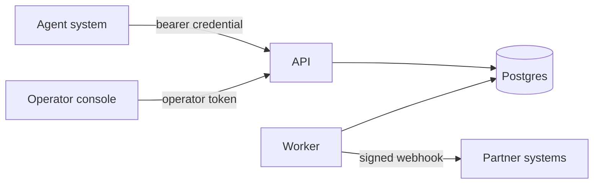

# Kavach Platform — Threat Model (Prototype)

A STRIDE-oriented threat model for the prototype. Scope: the on-prem stack
(API, worker, Postgres, console) and the substrate it runs.

## Assets

- The event log (source of truth) and the HMAC audit chain.
- The audit signing key and the operator/JWT secrets.
- Agent credentials and the decisions they gate.
- Personal/financial data referenced by evidence records.

## Trust boundaries

The network edge (TLS/mTLS, gateway) is a separate boundary terminated by
a reverse proxy in production.

## STRIDE

| Threat | Vector | Mitigation | Residual (prototype) |
|--------|--------|------------|----------------------|
| **Spoofing** | Forged agent identity | Credential verification via `sdk_bridge`; agent may act only as its own id | Fake verifier in demo mode is non-cryptographic by design |
| **Spoofing** | Forged operator | Operator bearer token, tenant-scoped | Shared token placeholder; replace with IdP/RBAC |
| **Tampering** | Alter stored events/audit | HMAC-SHA256 hash chain; signed export; recomputation detects change | Software key; HSM recommended |
| **Tampering** | Replay of a request | Idempotency keys dedupe state-changing POSTs | — |
| **Repudiation** | "The agent didn't do that" | Every action/decision is an immutable, chained, signed record with `decided_by` | — |
| **Information disclosure** | PII in events | Data minimisation: sensitive data by reference, not inline | Reference-store access control hardening pending |
| **Information disclosure** | Secrets in image | Secrets via env at deploy time, not baked in | — |
| **Denial of service** | Flooding the API | Edge rate limiting / WAF | Not implemented in prototype |
| **Elevation of privilege** | Agent exceeds scope | Default-deny policy; actions outside schema rejected and logged; step-up for high impact | — |
| **Elevation of privilege** | Cross-tenant access | Tenant scoping on all reads/writes | Single-tenant-per-deployment assumed in prototype |

## Abuse cases specific to agentic systems

- **Tool/scope escalation at runtime.** Mitigated: the action schema is
  provisioned; policy is default-deny; `effective_scope` from delegation
  bounds authorization ([ADR-0015](../adr/0015-pramana-sdk-packaging-and-agpl-posture.md)).
- **Silent high-impact action.** Mitigated: high-impact classes return
  `step_up` and require human resolution (EU AI Act Art. 14).
- **Audit gap during incident.** Mitigated: audit chaining is
  transactional with the event append; a missing link is detectable.

## Hardening backlog

HSM/KMS signing key with rotation; operator IdP + RBAC; chain-head lock
for concurrent writers; edge TLS/mTLS, rate limiting, WAF; multi-tenant
isolation review; reference-store access controls; DPIA with the partner
DPO.
